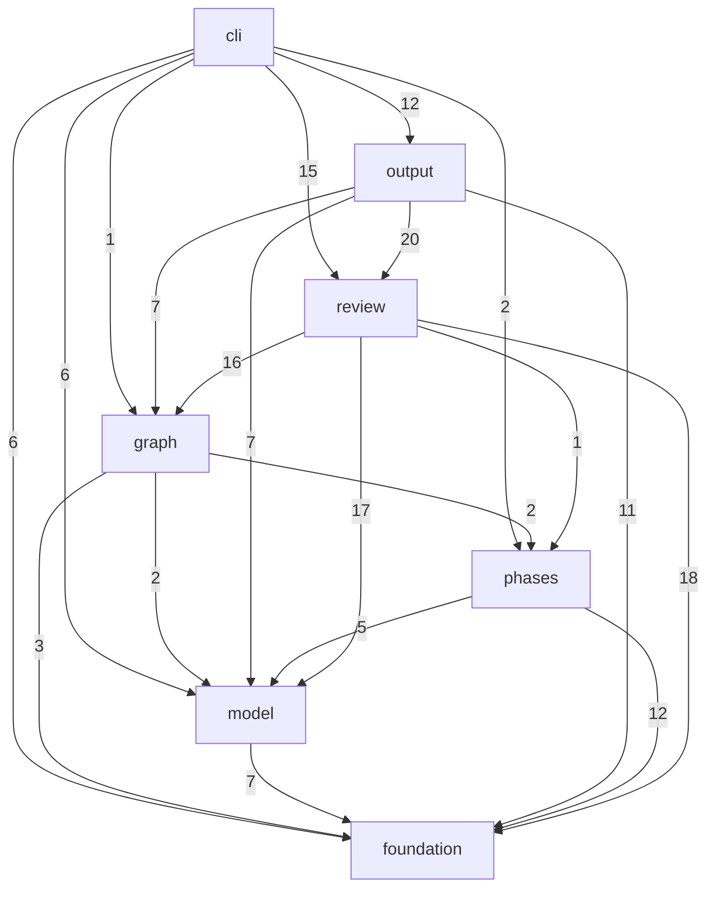

# Architecture

<!-- Rendered by anarch-lint render from the model 9baf32338db3. Edit the model, not this file. -->

## Subsystems

| Subsystem  | Packages                                                                                                                                                                                                                                                                                                                                                                                                                                                                                                                                                                                                                                                                                                                                                                                                                                                                                                                                                              | Interface                                                                                                                                                                                                                                                                                                                                                                                                                                                                                                                                                                                                                                                                                                                                                                                                                                                                                                                                                             | Owner |
| ---------- | --------------------------------------------------------------------------------------------------------------------------------------------------------------------------------------------------------------------------------------------------------------------------------------------------------------------------------------------------------------------------------------------------------------------------------------------------------------------------------------------------------------------------------------------------------------------------------------------------------------------------------------------------------------------------------------------------------------------------------------------------------------------------------------------------------------------------------------------------------------------------------------------------------------------------------------------------------------------- | --------------------------------------------------------------------------------------------------------------------------------------------------------------------------------------------------------------------------------------------------------------------------------------------------------------------------------------------------------------------------------------------------------------------------------------------------------------------------------------------------------------------------------------------------------------------------------------------------------------------------------------------------------------------------------------------------------------------------------------------------------------------------------------------------------------------------------------------------------------------------------------------------------------------------------------------------------------------- | ----- |
| cli        | `github.com/StevenACoffman/codetospec`, `github.com/StevenACoffman/codetospec/cmd/...`, `github.com/StevenACoffman/codetospec/tools/...`                                                                                                                                                                                                                                                                                                                                                                                                                                                                                                                                                                                                                                                                                                                                                                                                                              | `github.com/StevenACoffman/codetospec/cmd/codetospec`                                                                                                                                                                                                                                                                                                                                                                                                                                                                                                                                                                                                                                                                                                                                                                                                                                                                                                                 |       |
| output     | `github.com/StevenACoffman/codetospec/internal/render`, `github.com/StevenACoffman/codetospec/internal/verify`, `github.com/StevenACoffman/codetospec/internal/kiro`, `github.com/StevenACoffman/codetospec/internal/quire`, `github.com/StevenACoffman/codetospec/internal/state`, `github.com/StevenACoffman/codetospec/internal/ui`, `github.com/StevenACoffman/codetospec/internal/corpus`, `github.com/StevenACoffman/codetospec/internal/cedarpolicy`, `github.com/StevenACoffman/codetospec/internal/cerbos`, `github.com/StevenACoffman/codetospec/internal/packagemap`, `github.com/StevenACoffman/codetospec/internal/policyview`, `github.com/StevenACoffman/codetospec/internal/anarch`                                                                                                                                                                                                                                                                   | `github.com/StevenACoffman/codetospec/internal/render`, `github.com/StevenACoffman/codetospec/internal/verify`, `github.com/StevenACoffman/codetospec/internal/kiro`, `github.com/StevenACoffman/codetospec/internal/quire`, `github.com/StevenACoffman/codetospec/internal/state`, `github.com/StevenACoffman/codetospec/internal/ui`, `github.com/StevenACoffman/codetospec/internal/corpus`, `github.com/StevenACoffman/codetospec/internal/cedarpolicy`, `github.com/StevenACoffman/codetospec/internal/cerbos`, `github.com/StevenACoffman/codetospec/internal/packagemap`, `github.com/StevenACoffman/codetospec/internal/policyview`, `github.com/StevenACoffman/codetospec/internal/anarch`                                                                                                                                                                                                                                                                   |       |
| review     | `github.com/StevenACoffman/codetospec/internal/crosscheck`, `github.com/StevenACoffman/codetospec/internal/quality`, `github.com/StevenACoffman/codetospec/internal/questions`, `github.com/StevenACoffman/codetospec/internal/consistency`, `github.com/StevenACoffman/codetospec/internal/drift`, `github.com/StevenACoffman/codetospec/internal/grounding`, `github.com/StevenACoffman/codetospec/internal/inherit`, `github.com/StevenACoffman/codetospec/internal/specdiff`, `github.com/StevenACoffman/codetospec/internal/testreach`, `github.com/StevenACoffman/codetospec/internal/domainmodel`, `github.com/StevenACoffman/codetospec/internal/position`, `github.com/StevenACoffman/codetospec/internal/acceptance`, `github.com/StevenACoffman/codetospec/internal/alignment`, `github.com/StevenACoffman/codetospec/internal/concept`, `github.com/StevenACoffman/codetospec/internal/nfrtarget`, `github.com/StevenACoffman/codetospec/internal/policy` | `github.com/StevenACoffman/codetospec/internal/crosscheck`, `github.com/StevenACoffman/codetospec/internal/quality`, `github.com/StevenACoffman/codetospec/internal/questions`, `github.com/StevenACoffman/codetospec/internal/consistency`, `github.com/StevenACoffman/codetospec/internal/drift`, `github.com/StevenACoffman/codetospec/internal/grounding`, `github.com/StevenACoffman/codetospec/internal/inherit`, `github.com/StevenACoffman/codetospec/internal/specdiff`, `github.com/StevenACoffman/codetospec/internal/testreach`, `github.com/StevenACoffman/codetospec/internal/domainmodel`, `github.com/StevenACoffman/codetospec/internal/position`, `github.com/StevenACoffman/codetospec/internal/acceptance`, `github.com/StevenACoffman/codetospec/internal/alignment`, `github.com/StevenACoffman/codetospec/internal/concept`, `github.com/StevenACoffman/codetospec/internal/nfrtarget`, `github.com/StevenACoffman/codetospec/internal/policy` |       |
| graph      | `github.com/StevenACoffman/codetospec/internal/graph`                                                                                                                                                                                                                                                                                                                                                                                                                                                                                                                                                                                                                                                                                                                                                                                                                                                                                                                 | `github.com/StevenACoffman/codetospec/internal/graph`                                                                                                                                                                                                                                                                                                                                                                                                                                                                                                                                                                                                                                                                                                                                                                                                                                                                                                                 |       |
| phases     | `github.com/StevenACoffman/codetospec/internal/mapper`, `github.com/StevenACoffman/codetospec/internal/reducer`                                                                                                                                                                                                                                                                                                                                                                                                                                                                                                                                                                                                                                                                                                                                                                                                                                                       | `github.com/StevenACoffman/codetospec/internal/mapper`, `github.com/StevenACoffman/codetospec/internal/reducer`                                                                                                                                                                                                                                                                                                                                                                                                                                                                                                                                                                                                                                                                                                                                                                                                                                                       |       |
| model      | `github.com/StevenACoffman/codetospec/internal/extract`, `github.com/StevenACoffman/codetospec/internal/source`, `github.com/StevenACoffman/codetospec/internal/config`, `github.com/StevenACoffman/codetospec/internal/callers`, `github.com/StevenACoffman/codetospec/internal/locale`, `github.com/StevenACoffman/codetospec/internal/vocabulary`                                                                                                                                                                                                                                                                                                                                                                                                                                                                                                                                                                                                                  | `github.com/StevenACoffman/codetospec/internal/extract`, `github.com/StevenACoffman/codetospec/internal/source`, `github.com/StevenACoffman/codetospec/internal/config`, `github.com/StevenACoffman/codetospec/internal/callers`, `github.com/StevenACoffman/codetospec/internal/locale`, `github.com/StevenACoffman/codetospec/internal/vocabulary`                                                                                                                                                                                                                                                                                                                                                                                                                                                                                                                                                                                                                  |       |
| foundation | `github.com/StevenACoffman/codetospec/internal/atomicfs`, `github.com/StevenACoffman/codetospec/internal/ears`, `github.com/StevenACoffman/codetospec/internal/llm`, `github.com/StevenACoffman/codetospec/internal/sitter`, `github.com/StevenACoffman/codetospec/internal/textsim`, `github.com/StevenACoffman/codetospec/internal/workpool`, `github.com/StevenACoffman/codetospec/internal/communities`, `github.com/StevenACoffman/codetospec/internal/condition`, `github.com/StevenACoffman/codetospec/internal/d2`                                                                                                                                                                                                                                                                                                                                                                                                                                            | `github.com/StevenACoffman/codetospec/internal/atomicfs`, `github.com/StevenACoffman/codetospec/internal/ears`, `github.com/StevenACoffman/codetospec/internal/llm`, `github.com/StevenACoffman/codetospec/internal/sitter`, `github.com/StevenACoffman/codetospec/internal/textsim`, `github.com/StevenACoffman/codetospec/internal/workpool`, `github.com/StevenACoffman/codetospec/internal/communities`, `github.com/StevenACoffman/codetospec/internal/condition`, `github.com/StevenACoffman/codetospec/internal/d2`                                                                                                                                                                                                                                                                                                                                                                                                                                            |       |

## Layers

From the top, which may import every layer below it:

1. **command**: `github.com/StevenACoffman/codetospec`, `github.com/StevenACoffman/codetospec/cmd/...`, `github.com/StevenACoffman/codetospec/tools/...`
2. **output**: `github.com/StevenACoffman/codetospec/internal/render`, `github.com/StevenACoffman/codetospec/internal/verify`, `github.com/StevenACoffman/codetospec/internal/kiro`, `github.com/StevenACoffman/codetospec/internal/quire`, `github.com/StevenACoffman/codetospec/internal/state`, `github.com/StevenACoffman/codetospec/internal/ui`, `github.com/StevenACoffman/codetospec/internal/corpus`, `github.com/StevenACoffman/codetospec/internal/cedarpolicy`, `github.com/StevenACoffman/codetospec/internal/cerbos`, `github.com/StevenACoffman/codetospec/internal/packagemap`, `github.com/StevenACoffman/codetospec/internal/policyview`, `github.com/StevenACoffman/codetospec/internal/anarch`
3. **review**: `github.com/StevenACoffman/codetospec/internal/crosscheck`, `github.com/StevenACoffman/codetospec/internal/quality`, `github.com/StevenACoffman/codetospec/internal/questions`, `github.com/StevenACoffman/codetospec/internal/consistency`, `github.com/StevenACoffman/codetospec/internal/drift`, `github.com/StevenACoffman/codetospec/internal/grounding`, `github.com/StevenACoffman/codetospec/internal/inherit`, `github.com/StevenACoffman/codetospec/internal/specdiff`, `github.com/StevenACoffman/codetospec/internal/testreach`, `github.com/StevenACoffman/codetospec/internal/domainmodel`, `github.com/StevenACoffman/codetospec/internal/position`, `github.com/StevenACoffman/codetospec/internal/acceptance`, `github.com/StevenACoffman/codetospec/internal/alignment`, `github.com/StevenACoffman/codetospec/internal/concept`, `github.com/StevenACoffman/codetospec/internal/nfrtarget`, `github.com/StevenACoffman/codetospec/internal/policy`
4. **graph**: `github.com/StevenACoffman/codetospec/internal/graph`
5. **phases**: `github.com/StevenACoffman/codetospec/internal/mapper`, `github.com/StevenACoffman/codetospec/internal/reducer`
6. **model**: `github.com/StevenACoffman/codetospec/internal/extract`, `github.com/StevenACoffman/codetospec/internal/source`, `github.com/StevenACoffman/codetospec/internal/config`, `github.com/StevenACoffman/codetospec/internal/callers`, `github.com/StevenACoffman/codetospec/internal/locale`, `github.com/StevenACoffman/codetospec/internal/vocabulary`
7. **foundation**: `github.com/StevenACoffman/codetospec/internal/atomicfs`, `github.com/StevenACoffman/codetospec/internal/ears`, `github.com/StevenACoffman/codetospec/internal/llm`, `github.com/StevenACoffman/codetospec/internal/sitter`, `github.com/StevenACoffman/codetospec/internal/textsim`, `github.com/StevenACoffman/codetospec/internal/workpool`, `github.com/StevenACoffman/codetospec/internal/communities`, `github.com/StevenACoffman/codetospec/internal/condition`, `github.com/StevenACoffman/codetospec/internal/d2`

## Subsystem Dependencies

As measured in the code:

## Fitness Rules

| Rule                    | Kind       | Gate | Reason                                                                                                                     |
| ----------------------- | ---------- | ---- | -------------------------------------------------------------------------------------------------------------------------- |
| llm-only-in-phases      | dependents | fail | only the phases that ask a model, and the commands that wire them, reach the LLM client; the deterministic checks never do |
| writes-through-atomicfs | calls      | fail | internal/atomicfs is the only writer of output, so an interrupted run never leaves a half-written file (AGENTS.md)         |

## Finding Rules

| Rule                        | Gate              | Reason                                                                                                                                                                 |
| --------------------------- | ----------------- | ---------------------------------------------------------------------------------------------------------------------------------------------------------------------- |
| `interface-bypass`          | as the rule gives | every package of a subsystem is its interface here, so this rule only guards against a new package left out of the model                                               |
| `layer-order-violation`     | as the rule gives | the pipeline runs bottom up: foundations, the fact model, the MAP and REDUCE phases, the graph, the reviews of it, and the outputs, each reading only what is below it |
| `subsystem-order-violation` | as the rule gives | the subsystems follow the layers, so each can be tested with what lies below it                                                                                        |

## Quality Attributes

| Attribute       | Rules                                                                            |
| --------------- | -------------------------------------------------------------------------------- |
| reliability     | `fitness.dependents llm-only-in-phases`, `fitness.calls writes-through-atomicfs` |
| maintainability | `layers`, `subsystemOrder`, `interfaces`                                         |
