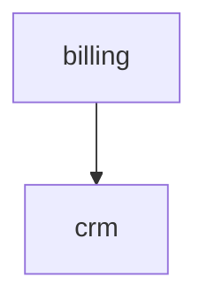

# Spécification générée

Graphe de connaissances des règles métier, extrait du code source par codetospec.

- Domaines : 2
- Entités : 1
- Endpoints : 1
- Règles : 1
- Énumérations : 1 (dont 1 avec transitions)
  - métier : 1 · présentation : 0 · technique : 0
  - explicites : 1 · implicites : 0

## Couverture

- Endpoints référencés par au moins une règle : 1/1 (100%)
- Entités touchées par au moins une règle : 1/1 (100%)
- Chunks en échec : 1/5
- Domaines en échec : 0/1
- Fichiers sans grammaire (fallback lignes) : routes/web.php
- Contre-vérification adversariale : 1 supported, 0 partial, 0 unsupported, 1 non vérifiées
- Ancrage mécanique (valeurs citées présentes dans le code) : 0 ancrées, 1 non ancrées, 0 sans valeur vérifiable
- Forme EARS : 1 règles n'ont pas la forme de leur type (`ears_issue`)
- Tests : 1 règles sur 1 ont leur code cité atteint par un test, en 3 appels au plus (`tests`, `tested_by`)

## Règles non ancrées

1 règles énoncent des valeurs absentes des lignes citées (valeur inventée ou citation décalée ; `@` indique où la valeur apparaît hors citation) :

- `rule.billing.prorata-activation` : 30 @app/Services/Billing/ProrataCalculator.php:9

## Code sans règle

1 morceaux de code de 1 domaines n'ont produit aucune règle (fichier généré, appel map ou reduce en échec) : ces domaines sont `coverage: partial`, l'absence d'une règle n'y prouve rien :

- `billing` : map-failed app/Services/Billing/Refunds.php:1-40

## Domaines

