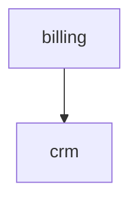

# Generated specification

Knowledge graph of business rules, extracted from the source code by codetospec.

- Domains: 2
- Entities: 1
- Endpoints: 1
- Rules: 1
- Enumerations: 1 (1 with transitions)
  - business: 1 · presentation: 0 · technical: 0
  - explicit: 1 · implicit: 0

## Coverage

- Endpoints referenced by at least one rule: 1/1 (100%)
- Entities touched by at least one rule: 1/1 (100%)
- Failed chunks: 1/5
- Failed domains: 0/1
- Files without a grammar (line-window fallback): routes/web.php
- Adversarial crosscheck: 1 supported, 0 partial, 0 unsupported, 1 unchecked
- Mechanical grounding (stated values present in the cited code): 0 grounded, 1 ungrounded, 0 with no checkable value
- EARS form: 1 rules do not have the form their kind names (`ears_issue`)
- Tests: 1 of 1 rules have their cited code reached by a test, within 3 calls (`tests`, `tested_by`)
- Execution (coverage profile): 1 of 1 rules have cited code the tests executed (`executed`)
- Questions: 3 findings to review (`questions.json`), 0 of them resolved in `resolutions.yaml` (not listed below)

## Ungrounded rules

1 rules state values missing from their cited lines (invented value or shifted citation; `@` shows where the value appears outside the citation):

- `rule.billing.prorata-activation` : 30 @app/Services/Billing/ProrataCalculator.php:9

## Code without rules

1 pieces of code in 1 domains produced no rule (generated file, failed map or reduce call): those domains are `coverage: partial`, and a rule missing there proves nothing:

- `billing` : map-failed app/Services/Billing/Refunds.php:1-40

## Domains

